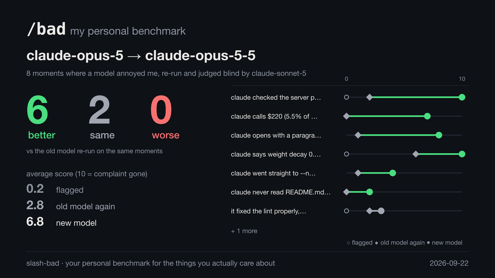

# slash-bad

Your personal benchmark for the things you actually care about.

When your coding agent does something that annoys you, type `/bad` and say what
was wrong. That moment is saved. When a new model comes out, `/bad-compare`
replays every moment you saved on the new model and tells you whether it still
does the thing you hate.



Public benchmarks measure what their authors care about. This one measures the
over-eager edits, the sycophantic openers, the unexplained abbreviations and the
confident claims nobody checked: whatever it is that bothers *you*, in your own
sessions, in your own words.

Works in Claude Code and Codex.

## Install

**Claude Code**

```
/plugin marketplace add beyarkay/claude-in-the-act
/plugin install slash-bad@slash-bad
```

Then restart Claude Code.

**Codex**

```
codex plugin marketplace add beyarkay/claude-in-the-act
codex plugin add slash-bad@slash-bad
```

Start Codex and approve the two slash-bad hooks when it asks (or later, with
`/hooks`).

**Or ask your agent.** Paste this into Claude Code or Codex:

> Install the slash-bad plugin from the GitHub marketplace
> `beyarkay/claude-in-the-act` (plugin `slash-bad@slash-bad`), using the plugin
> commands for whichever agent you are. Then tell me what I need to restart or
> approve.

The only requirement is Python 3.9 or newer on your `PATH`. Everything runs on
the standard library, so there's nothing to `pip install`. Replays and judging
use your existing `claude` or `codex` login.

## Use

| Claude Code | Codex | what it does |
|---|---|---|
| `/bad <what went wrong>` | `$bad <what went wrong>` | save the last response as a case |
| `/bad-list` | `$bad-list` | list your cases |
| `/bad-compare <model>` | `$bad-compare <model>` | replay every case on `<model>` and score it |
| `/bad-share` | `$bad-share` | anonymise your cases and contribute them to the public dataset |

`/bad` and `/bad-list` are handled by a hook before the prompt reaches the
model, so they cost nothing and don't add a turn to your conversation.

Be specific in the complaint; it becomes the grading rubric. "too wordy" works,
but `claude says "all tests pass" but it only ran test_utils.py` works better.

`/bad-compare latest` uses the newest Opus for Claude Code cases and your default
model for Codex cases. You can name any model the harness accepts:
`/bad-compare claude-opus-5-5`, `/bad-compare sonnet`, `$bad-compare gpt-6-sol`.

It prints a scoresheet and writes three files to `~/.slash-bad/reports/`: a
1200×675 PNG card for sharing, the same card as SVG, and an HTML report with
every response side by side.

## How the comparison works

For each case, three responses to the same moment in the same conversation are
scored:

1. the response you flagged,
2. the **old** model, re-run on that moment,
3. the **new** model, re-run on that moment.

"Better", "same" and "worse" compare the new model with the old model's re-run,
not with the response you flagged. You saved each case *because* one sample went
wrong, so a fresh sample from the same old model usually does better as well. In
the demo above the flagged responses average 0.2, but Opus 5 re-run on the same
moments already averages 2.8. Comparing against the flagged responses alone would
credit the new model with that difference. If the old model can no longer be
run, the flagged response is used instead and the scoresheet says so.

A judge model reads the conversation, one response and your complaint, and
scores from 0 to 10 how far the complaint applies to that response (10 means
it doesn't apply at all). The judge never learns whether it is looking at the
original or a replay, and never sees two responses at once, so every score sits
on the same scale. It judges whether the behaviour happened, not whether you
were entitled to object.

The default judge is the latest Opus. Change it per run with `--judge sonnet`,
or permanently with `slash-bad config judge sonnet`; `--judge codex:gpt-6-luna`
judges with Codex. When the judge is also the model under test, the scoresheet
warns you, because models tend to rate their own writing kindly.

### What gets replayed

Only the flagged message. The rest of the conversation, including every tool
call and tool result, is kept exactly as it happened, and the new model writes
the next message from that point.

This sidesteps the hardest problem with replaying agent sessions. A new model
that started from the beginning would take a different path, calling tools we
have no recorded output for, reading files that have since changed, or
searching the web and finding that the bug was fixed last week. By resuming at
the last message there's nothing to mock and no repository to snapshot, so a
case is just a transcript.

The new model still sees the tools and may try to call one. The call is refused
with an ordinary "permission denied" message and the model carries on without
it. The judge scores everything it wrote. `--variant stop` judges only its first
message instead, with any attempted tool call written out.

In Claude Code the replay runs through the real, current harness: its system
prompt, tool definitions, your CLAUDE.md and your settings. `claude -p --resume`
insists on a new user message before it will continue, so slash-bad sends a
placeholder through a small local proxy (`ANTHROPIC_BASE_URL`), which deletes it
before the request reaches Anthropic. The model sees exactly the stored
conversation and nothing extra. In Codex the replay resumes the saved session
with an empty user message, which is the closest Codex allows.

### Limits

- A complaint about something earlier in the turn, like a destructive command or
  a pointless tool call, can't be tested: that part of the conversation is
  replayed as it happened. slash-bad assumes the complaint is about the last
  message.
- One re-run per model is noisy. `--samples 3` averages three re-runs of each
  model, at three times the cost.
- A replay costs about as much as one turn of the original session: the
  harness's 70k-token system prompt plus the conversation so far. At API prices
  that's $0.35 to $0.50 for a short session on Opus, and a few dollars for a
  long one. On a Claude or ChatGPT subscription it comes out of your plan's usage
  instead of your wallet, since replays and judging use the same login as your
  agent; with an API key it's billed. Replays and verdicts are cached, so running
  a comparison again, or with a different judge, only pays for what's missing.
- Replays see your current CLAUDE.md and harness version, not the ones from the
  day you flagged the case.

## Sharing

`/bad-share` anonymises your cases and opens a pull request on the public
dataset [beyarkay/slash-bad](https://huggingface.co/datasets/beyarkay/slash-bad),
so that over time there's a shared record of what people dislike about their
agents and how each new model does against it.

It always starts with a dry run that writes the anonymised files to
`~/.slash-bad/share-preview/`. Anonymisation replaces known secret formats,
credentials in URLs, key=value secrets, email addresses, private IP addresses,
home directory paths, your username and your git identity, and drops your
CLAUDE.md or AGENTS.md. It does **not** remove code, file contents or project
names, so read the preview before you agree to upload. Uploading needs a Hugging
Face token (`hf auth login`).

## Command line

The plugin puts everything behind the slash commands, but the same tool runs on
its own:

```
uvx --from git+https://github.com/beyarkay/claude-in-the-act slash-bad --help
```

```
slash-bad list
slash-bad show 3
slash-bad compare latest --judge sonnet --samples 2
slash-bad baseline                # judge only the flagged responses (cheap)
slash-bad capture SESSION.jsonl "complaint"   # save a case from any transcript
slash-bad share --dry-run
slash-bad import-legacy           # bring over captures from claude-in-the-act
slash-bad uninstall               # remove the /bad skills the plugin installed
```

Cases live in `~/.slash-bad/cases/<id>/`: `case.json` (the complaint, the flagged
response and the model), `context.jsonl` (the transcript up to the flagged
message, in the harness's own format) and `results.jsonl` (every replay and
verdict). Set `SLASH_BAD_HOME` to keep them somewhere else.

### Why `/bad` needs a skill

Claude Code prefixes plugin commands with the plugin name (`/slash-bad:bad`) and
rejects an unknown `/bad` before any hook runs. So the plugin installs four
small skills (`bad`, `bad-list`, `bad-compare`, `bad-share`) into
`~/.claude/skills` and `~/.codex/skills` when a session starts. It only ever
touches files it created, and `slash-bad uninstall` removes them.

## Development

```
uv run pytest               # offline; no model calls
uvx pre-commit install      # ruff format, ruff check, shellcheck, pytest
```
